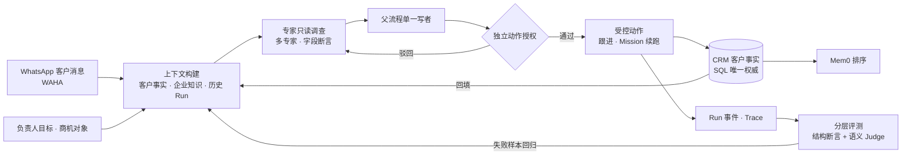
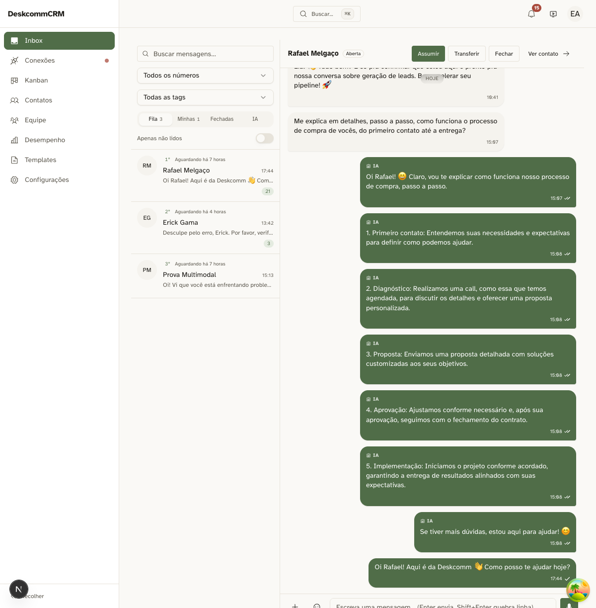
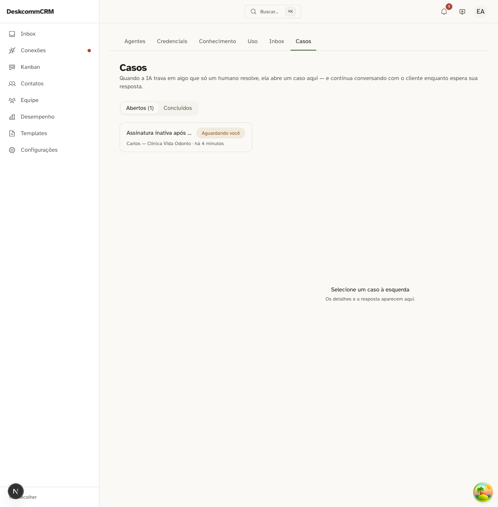
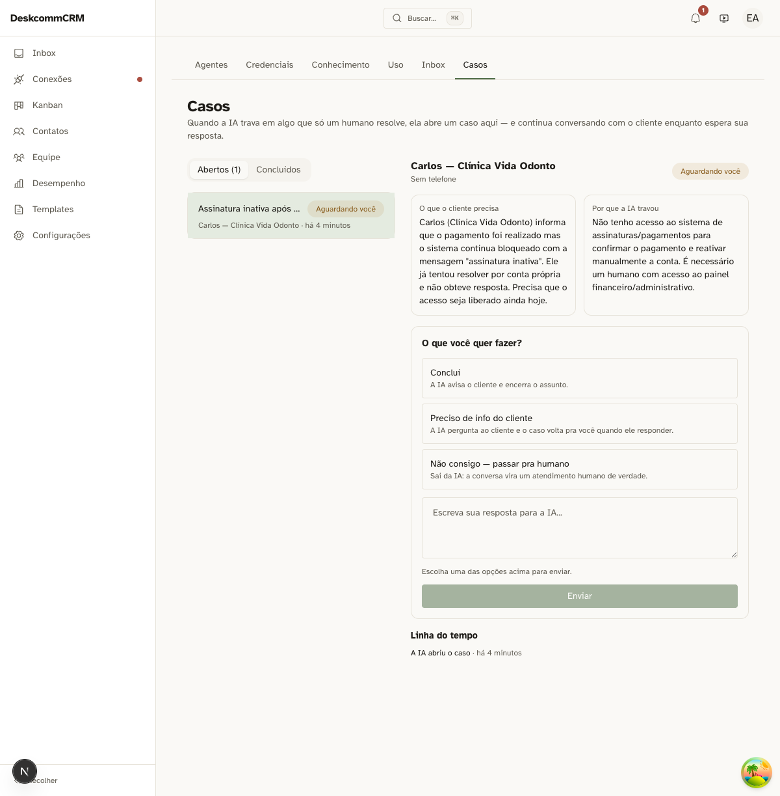

# 跨境客户经营系统

面向跨境销售在 WhatsApp 上的客户跟进场景的 Agent 原生经营工作台。让 Agent 读取客户、商机与企业知识，调用工具推进业务；让人看清它做了什么、依据什么，以及 CRM 发生了哪些变化。

[架构说明](docs/architecture/README.md) · [服务接入](docs/integrations/agent-services.md) · [开发配置](docs/SETUP.md) · [验证记录](docs/testing/system-acceptance-fixes-2026-10-03.md)

> CRM 保存业务事实，Agent 驱动跟进行动，Harness 管理执行边界与授权。

## 定位

跨境销售在 WhatsApp 上跟进客户，有两个根问题：

- **记忆不可信** —— 谁说过什么、客户偏好哪些，散落在会话与各处，Agent 无法区分事实与猜测。
- **自动跟进危险** —— 没有约束的自动发送可能把「在谈」写成「已成交」，造成真实损失。

本系统整合人工确认的客户记忆、企业知识与商机事实，支持多专家只读协作的商机分析、受控跟进与 Mission 续跑，并通过分层评测与失败样本回归形成可追查的修正闭环。

## 核心能力

### 客户确认记忆与 Mem0 排序

- 本地 SQL 保存人工确认的客户事实，作为唯一权威；Mem0 只对已确认条目排序，不做事实源。
- 远端命中须经归属标识、运行标识和内容哈希核对，并映射回本地记录 ID，否则丢弃。
- 服务不可用或部分返回时回退本地读取，并标明覆盖范围。
- 读回前后重新校验隐私与最新事实，避免把「未检索到」误判为「客户没有该偏好」。

### 商机专家协作与证据冲突

- 商机评审同时核对客户事实、跟进状态和公司政策；多个子代理直接写 CRM 会放大责任面、让冲突难审计。
- 专家仅作只读证据生产者，父流程作为单一写者并承接受控动作。
- 专家以字段值哈希加来源版本产出断言；父流程区分事实分歧、版本漂移与互补片段。
- 保留冲突位置及失败/部分结果，报告可追查分歧依据。

### 受控跟进与 Mission 续跑

- 负责人调整跟进方向时，以 Mission 方向版本创建新 Run，撤销旧待执行动作、使旧草稿过期并暂停旧客户发送。
- 成功回合中核对新方向是否进入最终模型上下文，将接收确认与运行消息同事务保存。
- 方向版本与接收记录可对应追溯；新指令仍须经过独立动作授权。

### 分层评测与失败样本回归

- 商机报告即使引用真实记录，也可能把「在谈」写成「已成交」。
- 先核对成功工具观察中的来源标识与结构化字段断言，再运行独立语义 Judge，以更严格的结论合并两层检查。
- 区分「引用未观察」「字段矛盾」「语义待复核」三类问题。
- 已存评价须匹配运行材料、评测规范及模型版本；资料变化后不能沿用旧高分。

## 架构概览



## 工作原理

```text
WhatsApp 客户消息 · 负责人目标 · CRM 对象
          │
          ▼
上下文构建：客户事实 · 企业知识 · 商机 · 历史 Run
          │
          ▼
专家只读调查（父子 Run，证据 + 字段断言）
          │
          ▼
父流程单一写者 ──────► 受控动作 ──────► 独立动作授权
          │                                    │
          ▼                                    ▼
Mission 方向版本 · Run 事件 · Trace     分层评测 · 失败样本回归
```

CRM 产品层通过自有接口调用 Agent 运行内核，数据库保存业务事实，Run、事件与检查点保存执行状态。客户记忆提供唯一事实源，企业知识提供依据，工具负责动作，分层评测负责反馈与回归。

## 界面预览

| WhatsApp 收件箱 | 商机案例列表 | 案例详情 |
| --- | --- | --- |
|  |  |  |

## 平台能力

- **Agent 工作台**：以任务和 CRM 对象为入口，支持只读调查与行动模式；在同一条时间线上查看上下文、决策、工具调用、Observation 与状态变化，并回放执行过程。
- **受控执行 Harness**：CRM 读写经过工具端口，权限、组织作用域与目标范围贯穿执行；按读取、可逆写入、外部动作和不可逆动作分类，自动执行读取与可补偿写入，对外动作经人工确认，并支持暂停、恢复、取消、租约、重试与累计预算控制。
- **内置 Agent**：

| Agent          | 职责                                                          |
| -------------- | ------------------------------------------------------------- |
| CRM 情报员     | 汇总客户、历史会话、商机、知识与记忆，形成带证据的客户画像    |
| 销售运营 Agent | 排查停滞商机、更新字段、调整阶段、安排后续跟进                |
| 客户沟通 Agent | 结合会话和知识起草回复，核对承诺依据，提出转人工动作          |
| CRM 主管 Agent | 跨漏斗、任务和执行记录调查异常，组织专职 Agent 协作并汇总结果 |

- **知识与记忆**：组织记忆、客户记忆、知识材料与运行历史分层管理，SQL 保持业务事实源；本地 RAG 与 WeKnora 检索提供知识来源、页面版本与引用。

## 灵活集成

- **模型**：组织级真实凭据、默认模型绑定、固定模型版本，以及 OpenAI、Anthropic、Google 和兼容模型接口。
- **Memory**：Mem0 客户记忆适配器，与 CRM 确认事实、同步队列和生命周期管理衔接。
- **LLM Wiki**：WeKnora 知识检索与来源接口，与本地 RAG、组织知识权限衔接。
- **Trace / Eval**：Langfuse 项目绑定、OTLP Trace 和评测分数投递。
- **WhatsApp**：WAHA 会话与消息工具，将客户沟通纳入审批和审计。
- **飞书内部协作**：企业身份映射、成员绑定、消息队列、回复关联与任务续跑接口。

第三方服务按组织绑定和启用，接入配置由服务端管理。模型凭据与服务凭据在服务端保管，不写入运行事件或提交记录。

## 快速开始

### 本地开发

准备 Node.js 22+、pnpm，以及开发用 Supabase 和 Redis 配置。

```bash
git clone https://github.com/lau0708/AiNativeCrm.git
cd AiNativeCrm
pnpm install --frozen-lockfile

# 仅在配置文件不存在时创建，保留已有配置
test -e .env.local || cp .env.example .env.local
test -e .env || touch .env
```

按照 [开发配置指南](docs/SETUP.md)填写 Supabase、Redis、应用地址及服务端加密配置；新开发数据库按指南初始化。已有数据库按迁移流程更新。

在不同终端中启动：

```bash
# Web
pnpm dev --port 3000

# Agent 执行进程
pnpm worker

# 本地辅助调度
pnpm dev:crons
```

打开 [本地工作台](http://localhost:3000/app/ai/workbench)，登录后在组织模型配置页绑定真实模型凭据，选择内置 Agent、CRM 对象和任务开始运行。

Mem0、WeKnora 与 Langfuse 的本地服务部署和组织绑定，见 [本地服务指南](infra/local-agent-services/README.md)与[接入契约](docs/integrations/agent-services.md)。

### 演示与真实运行回放

```bash
node scripts/serve-agent-demo.mjs
```

打开 [演示工作台](http://127.0.0.1:3008/#/app/ai/workbench)。演示包含合成 CRM 场景与脱敏的真实模型录制；“真实模型录制”展示历史输入输出、工具调用、记忆、知识引用与评测，不重新发起模型请求。演示页面与真实后端独立运行。

### 常用命令

| 命令                             | 用途                         |
| -------------------------------- | ---------------------------- |
| `pnpm dev`                       | 启动开发 Web 服务            |
| `pnpm worker`                    | 启动 Agent 执行进程          |
| `pnpm dev:crons`                 | 启动本地辅助调度             |
| `pnpm ai:agents:ensure-builtins` | 为已有组织幂等补齐内置 Agent |
| `pnpm typecheck`                 | 类型检查                     |
| `pnpm lint`                      | 代码检查                     |
| `pnpm test:unit`                 | 单元测试                     |
| `pnpm test:db`                   | 数据库不变量与隔离检查       |
| `pnpm test:e2e`                  | 浏览器测试                   |
| `pnpm test:e2e:acceptance`       | 专项验收测试                 |
| `pnpm test:e2e:live`             | 真实模型场景测试             |
| `pnpm build`                     | 构建应用                     |

## 项目状态

当前为内部研发版本，主分支围绕 Agent 工作台、受控 CRM 工具、多 Agent 协作、商机 Mission、知识记忆和 Eval 持续迭代。

- **真实运行记录**：已沉淀真实模型、多 Agent、Mem0 / WeKnora / Langfuse 联调与脱敏回放。[查看运行记录](docs/testing/agent-services-real-run-2026-10-03.md) · [查看三服务联调](docs/testing/local-agent-services-connected-2026-10-03.md)
- **系统复验记录**：2026-10-03 完成单元测试、数据库不变量、关键浏览器场景及真实模型复验。[查看复验报告](docs/testing/system-acceptance-fixes-2026-10-03.md)
- **工程复核记录**：2026-10-05 类型检查、lint、构建与全量单测通过，单测 1,324 个文件、12,958 项通过。[查看工程复核](docs/testing/repository-hygiene-2026-10-05.md)

执行记录用于证明实际链路，业务结果由证据与验收条件核验；详细测量范围保存在对应报告中。

## 技术与目录

基于 Next.js、React、TypeScript、Tailwind CSS、Supabase、Pi Agent Core / Pi AI，以及 Vitest、Playwright 构建。

| 目录                  | 内容                                              |
| --------------------- | ------------------------------------------------- |
| `app/`、`components/` | CRM 页面、Agent 工作台与产品 API                  |
| `lib/`                | CRM 领域逻辑、工具、Harness、知识记忆与服务适配器 |
| `workers/`            | 后台 Agent 执行                                   |
| `supabase/`           | 数据库基线、迁移与权限规则                        |
| `infra/`              | 服务部署与接入配置                                |
| `tests/`              | 单元、数据库与浏览器测试                          |
| `examples/`           | 演示场景与回放入口                                |
| `docs/`               | 架构、规格、配置与验证记录                        |

本地输出放在 `output/`、`tmp/` 或 `scratchpad/`，历史交接放在 `docs/handoffs/`。环境文件、真实凭据、客户数据和数据库备份不进入版本库。

## 文档

- [文档入口](docs/index.md)
- [Agent 架构](docs/architecture/README.md)
- [商机 Mission 与执行状态](docs/architecture/mission-state.md)
- [飞书内部协作接口](docs/architecture/internal-collaboration-feishu.md)
- [Memory、Wiki 与 Langfuse 接入](docs/integrations/agent-services.md)
- [本地服务启动与联调](infra/local-agent-services/README.md)
- [专项 E2E 测试入口](tests/e2e/configs/README.md)

内部开发先阅读 [AGENTS.md](AGENTS.md)与[CLAUDE.md](CLAUDE.md)。本项目包含继承代码，遵循 [MIT 许可及原版权声明](LICENSE)。
